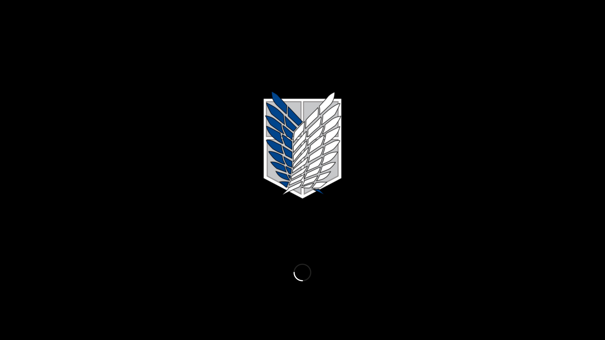

# Wings of Freedom

Fan-made **Wings of Freedom** splash screens for Linux:

- **KDE Plasma 6** splash screen, shown while Plasma starts after login.
- **Plymouth** boot splash screen, shown while the system boots.

![./kde-splash/contents/previews/splash.png]



## Repository layout

| Path          | Contents                                                                                |
| ------------- | --------------------------------------------------------------------------------------- |
| `kde-splash/` | Plasma 6 Look-and-Feel splash package (`metadata.json`, `Splash.qml`, images, preview). |
| `plymouth/`   | Plymouth script theme (`freedom.plymouth`, `freedom.script`, logo and spinner).         |

## KDE Plasma 6

### Requirements

- KDE Plasma 6

### Install

From the repository root, copy the package into your Plasma look-and-feel directory:

```bash
mkdir -p ~/.local/share/plasma/look-and-feel/wings-of-freedom
cp -r kde-splash/. ~/.local/share/plasma/look-and-feel/wings-of-freedom/
```

To install it for all users, use the system-wide directory instead:

```bash
sudo mkdir -p /usr/share/plasma/look-and-feel/wings-of-freedom
sudo cp -r kde-splash/. /usr/share/plasma/look-and-feel/wings-of-freedom/
```

> **Copy the files; do not create a symlink.** Tools that uninstall Plasma packages may follow
> the link and delete your source checkout.

### Apply

Open **System Settings → Appearance & Style → Splash Screen**, select **Wings of Freedom**,
and click **Apply**. The splash is shown during login, so log out and back in to see it.

### Update or uninstall

After editing files in `kde-splash/`, copy the updated files again:

```bash
cp -r kde-splash/. ~/.local/share/plasma/look-and-feel/wings-of-freedom/
```

To uninstall, remove the installed copy:

```bash
rm -rf ~/.local/share/plasma/look-and-feel/wings-of-freedom
```

For a system-wide installation, use `sudo` and `/usr/share/plasma/look-and-feel/wings-of-freedom`
instead. Select another splash screen in System Settings after removing it.

## Plymouth

### Requirements

- Plymouth installed and enabled in your initramfs (for example, the `plymouth` hook in
  `mkinitcpio.conf` on Arch-based systems).
- The theme is installed to `/usr/share/plymouth/themes/freedom`. This path is hardcoded in
  `freedom.plymouth`, so update that file if you want to install it elsewhere.

### Install and activate

```bash
sudo install -d /usr/share/plymouth/themes/freedom
sudo install -m644 \
  plymouth/freedom.plymouth \
  plymouth/freedom.script \
  plymouth/freedom.png \
  plymouth/spinner.png \
  /usr/share/plymouth/themes/freedom/

sudo plymouth-set-default-theme -R freedom
```

`-R` rebuilds the initramfs so the new theme is included. On distributions that do not support
`-R`, rebuild the initramfs with your usual tool after changing the theme.

Check the selected theme with:

```bash
plymouth-set-default-theme --list
```

A reboot is the simplest way to preview the new boot splash.

### Uninstall

```bash
sudo plymouth-set-default-theme -R bgrt
sudo rm -rf /usr/share/plymouth/themes/freedom
```

Replace `bgrt` with another installed theme from `plymouth-set-default-theme --list`.

## Credits

- Original **Arch Simple Blue Splash Screen** by mrmaire:
  <https://store.kde.org/p/1312961>
- KDE 6 adaptation by kraken-afk (Romeo Noveanre)
- Fork by dancp

See [`kde-splash/AUTHORS`](kde-splash/AUTHORS) for details.

## License

GPL-3.0. See [`kde-splash/LICENSE`](kde-splash/LICENSE).

This is a fan-made theme. _Attack on Titan_ and the Wings of Freedom emblem belong to their
respective rights holders.
